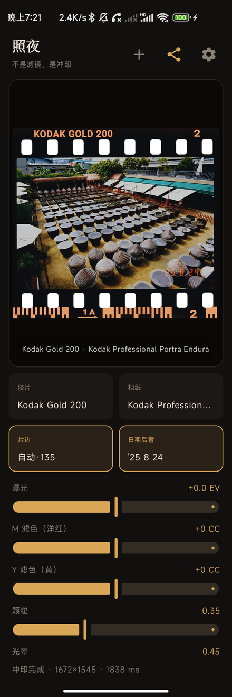
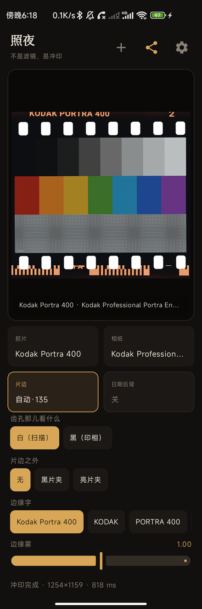
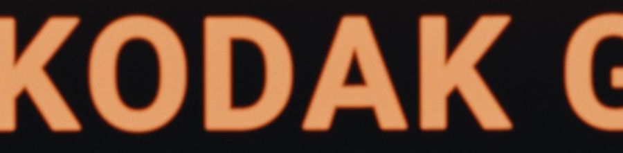

# Zhaoye / 照夜

[](https://github.com/Shawn-SU-1/zhaoye/releases/latest)
[](README.en.md#install)
[](README.en.md#credits-and-licenses)
[](https://github.com/Shawn-SU-1/zhaoye/blob/main/LICENSE)

[简体中文](README.md) · [日本語](README.ja.md) · **English**

> **Download Zhaoye 0.2.2**
>
> [GitHub Release](https://github.com/Shawn-SU-1/zhaoye/releases/latest) ·
> [Lanzou Cloud mirror (password 23nt)](https://wwbjy.lanzouv.com/b0hebl34b) ·
> [Baidu Netdisk (code h1ec)](https://pan.baidu.com/s/1f_aZvZQsR4no8KrLcxiJHQ?pwd=h1ec)
>
> Requires a real arm64 device running Android 8.0+ with Vulkan 1.1. The GitHub
> release is the official `0.2.1` package. The Lanzou mirror is available for
> mainland China. The app also checks for updates at launch without blocking edits.

An Android darkroom that runs the same C++20 spectral print engine on a phone
through Vulkan compute. It is not a collection of filters redrawn to imitate
film.

If installation fails, see [Install](#install). For planned work, see
[ROADMAP.md](ROADMAP.md).

> **Zhaoye** is named after 照夜白, Emperor Xuanzong's white horse: white enough
> to be seen even at night. Han Gan painted it, and *Night-Shining White* is now
> in the Metropolitan Museum of Art. A darkroom is the same kind of room: it is
> dark until light is let in and an image begins to surface. The name is not
> about brightening a photograph. It is about letting the latent image be seen.

Package name: `com.shawn.zhaoye`. The native library is still called
`libspektralab.so`, after the upstream SpektraLab port from which it comes.

## The 0.2 workflow

- Single-screen darkroom: photograph, four parameter groups and bottom
  navigation remain visible together.
- Four parameter groups: Tone, Texture, Film and Film Edge.
- Pinch to zoom, double-tap to enlarge, and a 3400 px detail frame after the
  gesture settles for checking grain and edge lettering.
- Split original/result comparison. With film edge enabled, the comparison uses
  a matching print without edge or date imprint so both sides align.
- App-specific benchmark based on real 800 px renders, film-edge rendering,
  reprints and the 1600 px finishing frame. It recommends whether interactive
  preview should be enabled.
- Export size can be selected directly before saving or sharing.

```text
scene light → film exposure → development (dye density) → enlarger
→ photo paper → development → scan → sRGB
```

## Screens

| Darkroom | Film edge |
|---|---|
|  |  |

The black border is the film rebate: unexposed base, sprocket holes, edge
lettering, frame numbers, DX code and the date back. It is not the edge of the
paper. Photographic paper itself has no border.



The image above is a 4× enlargement of the top edge lettering. It is upright
and not cropped. Both properties were bugs at one point; see item 10 in
`docs/acceptance-2026-10-29.md`.

## Credits and licenses

Two layers of attribution are required:

| What | Source | License |
|---|---|---|
| Film physics, 28 measured color configurations, print LUTs | [andreavolpato/spektrafilm](https://github.com/andreavolpato/spektrafilm) by Andrea Volpato | Configurations and LUTs: **CC BY-SA 4.0** |
| Native C++/Vulkan engine port and C ABI | [JamesQiu2005/SpektraLab](https://github.com/JamesQiu2005/SpektraLab) by Hanze Qiu | **GPL-3.0-or-later** |
| Android layer, JNI, UI and LibRaw integration | This project | **GPL-3.0-or-later** |

The original project is Andrea Volpato's **spektrafilm**, a Python/numba
reference implementation containing the measured stock data. SpektraLab is its
native C++/Metal port. Zhaoye runs that port on Android through Vulkan.

The engine is vendored as a **trimmed copy** under `engine/`, containing only the
`include/` and `src/` files needed to build `libspektralab.so`, plus
`third_party/{volk,stb}`. See `engine/README.md` and
`patches/0001-android-port.patch` for the changes relative to upstream
`fd891c6`.

**License:** this application is a derivative of GPL-3.0-or-later software and
must remain open when distributed. Profiles and print LUTs derived from
spektrafilm remain **CC BY-SA 4.0**; attribution and license notices must be
preserved, modifications stated, and adaptations distributed under the same
license.

## Repository layout

```text
app/src/main/
├── cpp/                    JNI bridge, portable rasterizer and device probes
├── assets/engine/          constants, profiles, LUTs, fonts and Vulkan SPIR-V
└── java/com/shawn/zhaoye/  Compose UI, view model, engine API and settings
engine/                     trimmed upstream engine source
scripts/                    native and LibRaw build scripts
patches/                    Android port patch
```

## Build

Requirements: JDK 21, Android SDK platform 37 and build tools, NDK r28c+, and
LibRaw 0.22.2 source.

```bash
export JAVA_HOME=/path/to/jdk-21
export ANDROID_HOME=/path/to/Android/Sdk
export ANDROID_NDK_ROOT=/path/to/android-ndk-r28c
export LIBRAW_SRC=/path/to/LibRaw-0.22.2

bash scripts/build-libraw.sh
bash scripts/build-native.sh
./gradlew assembleDebug
```

`scripts/env.sh` searches `$ANDROID_NDK_ROOT`, `../deps/` and `third_party/`.
NDK and LibRaw are not committed. Resources and SPIR-V are committed; rebuild
native code only after changing the engine or compute shaders.

Only `arm64-v8a` is built. `minSdk` is 26 and `targetSdk` is 36. Emulators do not
run the Vulkan pipeline; a real device with Vulkan 1.1 is required.

## Install

Download `Zhaoye-0.2.2-arm64-v8a.apk` from
[Releases](https://github.com/Shawn-SU-1/zhaoye/releases/latest), or use the
[Lanzou mirror](https://wwbjy.lanzouv.com/b0hebl34b) (password `23nt`) or
[Baidu Netdisk mirror](https://pan.baidu.com/s/1f_aZvZQsR4no8KrLcxiJHQ?pwd=h1ec)
(extraction code `h1ec`). This is a sideloaded
APK, so Android may ask for permission to install from an unknown source.

Release certificate SHA-256:
`c4b5c76576838005bf90de0a55331341d9b3132e0ace0077a581385f3b43ca65`

```bash
sha256sum Zhaoye-0.2.2-arm64-v8a.apk
# 62a1893355fca82df05dedeb42857424b8c65574712974e6add1003cf16f144c
```

Uninstall an older local debug build before installing a release build; the
signatures differ.

## Measured performance

Xiaomi `cetus`, Adreno 660 and Android 11:

- 800 px full spectral render: roughly 2.9 fps / 343 ms
- Cached-negative reprint: roughly 9.9 fps / 101 ms
- 800 px render with film edge: roughly 1.5 fps / 651 ms
- 1600 px finishing render: roughly 1.5 s
- App-specific benchmark score: 45/100, which recommends disabling interactive
  preview on this device

The rendering cost depends heavily on the GPU driver. Better devices may score
differently; run the benchmark in App Settings.

## RAW

LibRaw 0.22.2 is linked statically into `libspektralab.so`.

```text
file → LibRaw (half-size AHD, ProPhoto, 16-bit)
     → box downscale → spk_open
```

Decode, downscale and session creation happen inside one JNI call. The phone
uses half-size demosaic to avoid the 688 MB peak of a full 42 MP decode; the
result is still around 3984 px, above the 3200 px export tier.

Supported inputs include ARW, NEF, CR2/CR3, DNG, RAF, ORF and RW2, subject to
LibRaw support. Nikon HE/HE* compressed NEF is not supported by LibRaw 0.22.2
and returns an explicit error.

## Film edge

`engine/src/pipeline/overscan.cpp` implements the gate shape, sprocket holes,
edge lettering, DX barcode, date back, light leaks and fog. Apple
CoreGraphics/CoreText and Accelerate calls are replaced by the Android raster
layer in `app/src/main/cpp/spk_raster.*`; four Metal kernels have Vulkan GLSL
counterparts.

The bundled DroidSans fonts live under `assets/engine/fonts/` so edge rendering
does not depend on fonts installed by the ROM.

## Known limitations

- The App only targets `arm64-v8a` and requires Android 8.0+ with Vulkan 1.1.
- Interactive preview is useful but not 60 fps on older GPUs. The benchmark can
  recommend turning it off.
- Export sizes are 3200, 4800, 6400 and source resolution. Source resolution is
  practical for RAW only; JPEG falls back to 3200 to avoid excessive heap use.
- On Adreno 660, a 42 MP source-resolution export can exceed the Vulkan storage
  buffer limit and lose the device. Zhaoye rebuilds the engine and falls back
  to 3200.
- Half-frame stitching, CLI and MCP are not available. Their upstream
  implementations depend on Apple services and would require a rewrite.
- Android Motion Photos can usually be selected and edited through their still
  cover: the system picker exposes the primary JPEG/HEIF image to the App. Zhaoye
  does not yet detect the embedded clip, edit its frames or export a new motion
  photo.

See [ROADMAP.md](ROADMAP.md) for planned work and explicit non-goals.

## Large exports

A full 7968×5320 float32 RGB frame is 485 MiB, approximately 95% of the 512 MiB
storage-buffer limit reported by Adreno 660. The pipeline needs several
full-resolution images alive at once, so Vulkan can fail with
`VK_ERROR_DEVICE_LOST (-4)`. 6400×4273 uses about 315 MiB and completes.

The long-term solution is overlapped tiled rendering, including halo margins
for grain and halation. It is an engine-level change and not implemented yet.

## Troubleshooting

Open an [issue](https://github.com/Shawn-SU-1/zhaoye/issues/new/choose) and
attach the diagnostic report generated by **Settings → Export Log**. The report
includes model, Android version, ABI, memory, engine capabilities, recent app
events and logcat. It may contain photo filenames or paths; remove anything you
do not want to publish.
